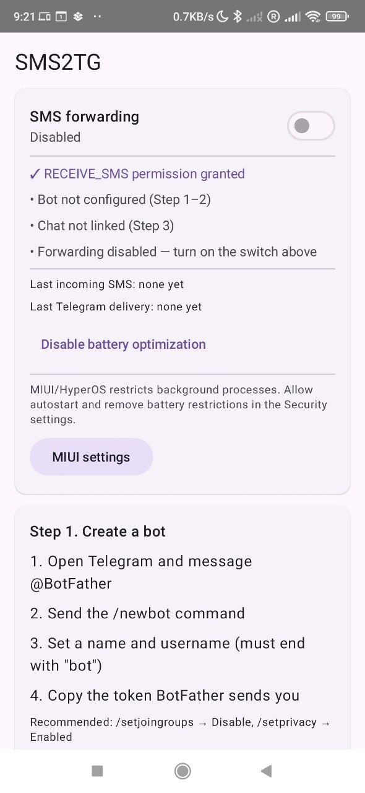
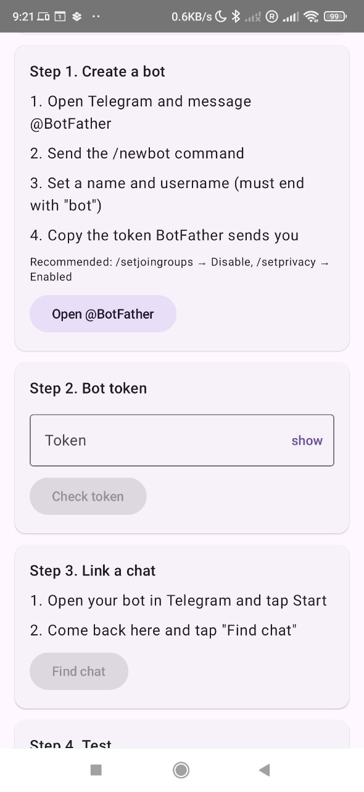
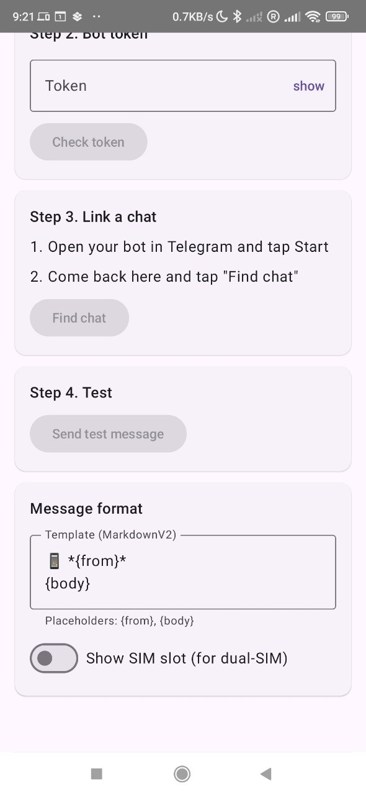

# SMS2TG

> Forward incoming SMS from your Android phone to a private Telegram chat via your own bot. No IFTTT, no third‑party servers — just your device and Telegram's Bot API.

[](LICENSE)
[](https://developer.android.com/tools/releases/platforms)
[](https://kotlinlang.org/)

<p align="center">
  
  
  
</p>

## Features

- **Background‑first.** Foreground service keeps the SMS receiver alive even when the app is closed — including on aggressive OEM skins (MIUI/HyperOS, ColorOS, EMUI).
- **Private by design.** The bot token is stored in Android Keystore via `EncryptedSharedPreferences` and never leaves your device.
- **Reliable delivery.** Outgoing messages are handed to WorkManager with exponential backoff; network drops and transient Telegram errors retry automatically.
- **Guided setup.** 4‑step wizard walks you through BotFather → token → chat binding → test message.
- **Diagnostics built in.** Status card surfaces permission state, last SMS seen, last delivery, last error.
- **Customizable template.** MarkdownV2 template with `{from}` / `{body}` placeholders, optional SIM slot for dual‑SIM.
- **OEM hints.** On Xiaomi / Redmi / POCO devices, a dedicated button opens MIUI's autostart settings.

## How it works

```
┌──────────────┐   SMS_RECEIVED   ┌─────────────┐   OneTimeWorkRequest   ┌────────────────┐
│  Android OS  │ ───────────────> │ SmsReceiver │ ─────────────────────> │ ForwardSmsWorker│
└──────────────┘   broadcast      └─────────────┘   (retry w/ backoff)   └────────┬───────┘
                                                                                  │
                                                                  Telegram Bot API │ sendMessage
                                                                                  ▼
                                                                           ┌────────────┐
                                                                           │  your chat │
                                                                           └────────────┘
```

A foreground service with `foregroundServiceType="dataSync"` and a silent `IMPORTANCE_MIN` notification keeps the process alive so the manifest‑registered receiver fires even after the user swipes the app away.

## Tech stack

| Area              | Choice                                                |
| ----------------- | ----------------------------------------------------- |
| Language / UI     | Kotlin 2.1, Jetpack Compose, Material 3               |
| Background        | WorkManager + CoroutineWorker, Foreground Service     |
| HTTP / JSON       | OkHttp 4, kotlinx.serialization                       |
| Secure storage    | `androidx.security:security-crypto` (Android Keystore)|
| Min / Target SDK  | 26 (Android 8) / 35 (Android 15)                      |

## Install

Grab a signed APK from the [Releases](../../releases) page, transfer it to the phone, and open the file to install. You'll need to allow installs from unknown sources for your file manager.

On first launch, grant `RECEIVE_SMS` and notification permissions.

## Setup

1. Message [@BotFather](https://t.me/BotFather) → `/newbot` → copy the token.
   <br>*(Recommended: `/setjoingroups → Disable`, `/setprivacy → Enabled`.)*
2. Paste the token into the app → **Check token**.
3. In Telegram, open your bot and send `/start`. Back in the app, tap **Find chat**.
4. **Send test message** — you should see it arrive in Telegram.
5. Toggle **SMS forwarding** on.

### MIUI / HyperOS

Xiaomi's power management will silently kill the process unless you opt out. The app shows a **MIUI settings** shortcut when it detects these ROMs — use it to enable autostart and remove battery restrictions.

## Building from source

### Android Studio

Open the project — Android Studio syncs Gradle, downloads the SDK and builds.
`Build → Build Bundle(s)/APK(s) → Build APK(s)`.

### Command line

Requires JDK 17 and the Android command‑line tools:

```bash
brew install openjdk@17
brew install --cask android-commandlinetools
export JAVA_HOME=$(brew --prefix)/opt/openjdk@17/libexec/openjdk.jdk/Contents/Home
export ANDROID_HOME=$(brew --prefix)/share/android-commandlinetools
yes | sdkmanager --licenses
sdkmanager "platforms;android-35" "build-tools;35.0.0" "platform-tools"

./gradlew assembleDebug
# → app/build/outputs/apk/debug/app-debug.apk
```

### Signed release build

Generate a keystore once and create `keystore.properties` at the repo root:

```bash
keytool -genkeypair -v \
  -keystore app/release.keystore -alias sms2tg \
  -keyalg RSA -keysize 4096 -validity 36500
```

```properties
# keystore.properties (gitignored)
storeFile=release.keystore
storePassword=<your-store-password>
keyAlias=sms2tg
keyPassword=<your-key-password>
```

```bash
./gradlew assembleRelease
# → app/build/outputs/apk/release/app-release.apk
```

> **Keep the keystore safe.** Without it you cannot ship an update that installs over the current version — users will have to uninstall first.

### Publishing a release from CI

`.github/workflows/release.yml` builds and publishes a signed APK when a `v*` tag is pushed. It expects the following repository secrets:

| Secret                     | What                                                                 |
| -------------------------- | -------------------------------------------------------------------- |
| `KEYSTORE_BASE64`          | `base64 -w0 app/release.keystore` — the keystore file itself.        |
| `KEYSTORE_STORE_PASSWORD`  | `storePassword` from `keystore.properties`.                          |
| `KEYSTORE_KEY_PASSWORD`    | `keyPassword` from `keystore.properties`.                            |
| `KEYSTORE_KEY_ALIAS`       | `keyAlias` from `keystore.properties` (typically `sms2tg`).          |

Once set, tag and push:

```bash
git tag v0.1.0
git push --tags
```

The workflow assembles a release APK, names it `sms2tg-<version>.apk`, and attaches it to a new GitHub Release with auto‑generated notes.

## Testing SMS on an emulator

```bash
adb emu sms send +10005550100 "hello"
```

## Security notes

- The token is encrypted at rest using a Keystore‑backed master key; a factory reset invalidates it.
- The bot is wired to a single chat id; even if the token leaks, messages still go only to that chat.
- The app requests no analytics, ad or tracking permissions — check `AndroidManifest.xml` for the full list.

## Known limitations

- **OEM background restrictions.** Foreground service mitigates most of this, but some aggressive ROMs still require manual whitelisting.
- **Telegram availability.** Bot API is blocked in a handful of jurisdictions; a VPN is needed there.
- **Dual‑SIM attribution** relies on vendor‑specific intent extras and may be unavailable on some phones.

## Contributing

PRs welcome — see [CONTRIBUTING.md](CONTRIBUTING.md) for setup, style, and PR expectations. Before pushing, run `./gradlew lintDebug` and make sure `./gradlew assembleDebug` passes.

## License

[MIT](LICENSE) © 2026 Eugene Shulepin.
